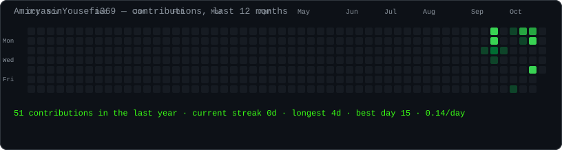

<h2>
  <code style="color: #39FF14; font-family: 'Courier New', monospace;">amiryasin@github ~ $ whoami --ascii</code>
</h2>

 

<h2>
  <code style="color: #39FF14; font-family: 'Courier New', monospace;">amiryasin@github ~ $ now-playing</code>
</h2>

 

<h2>
  <code style="color: #39FF14; font-family: 'Courier New', monospace;">amiryasin@github ~ $ whoami --verbose</code>
</h2>

 

<h2>
  <code style="color: #39FF14; font-family: 'Courier New', monospace;">amiryasin@github ~ $ cat contact.txt</code>
</h2>

 

